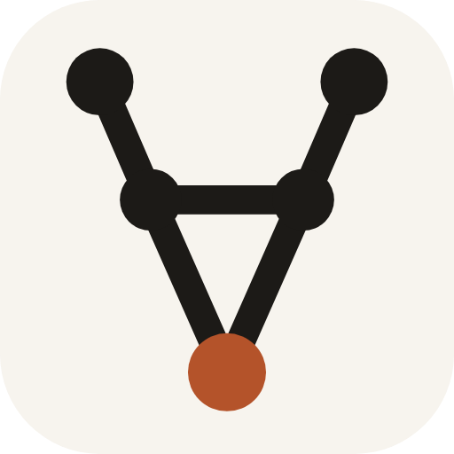
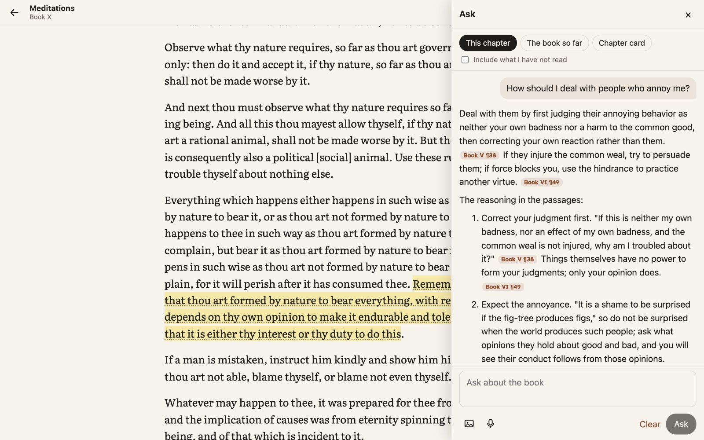
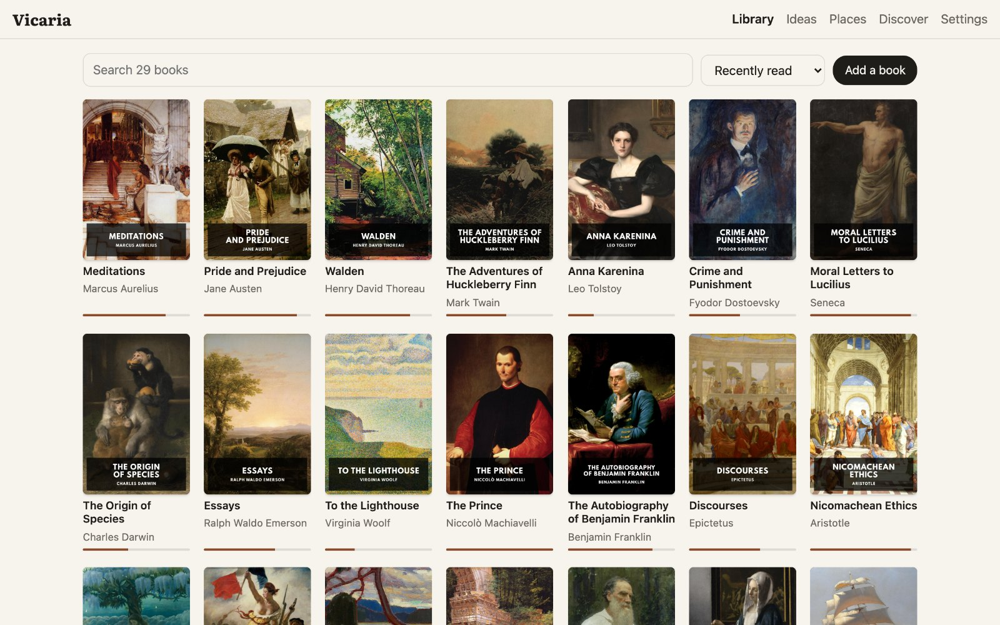
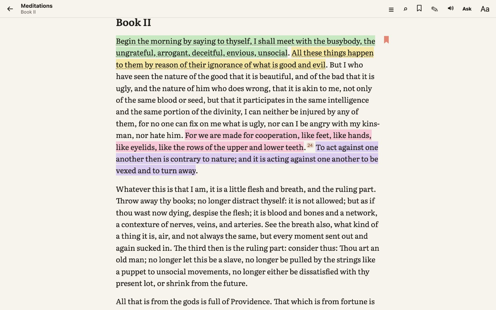
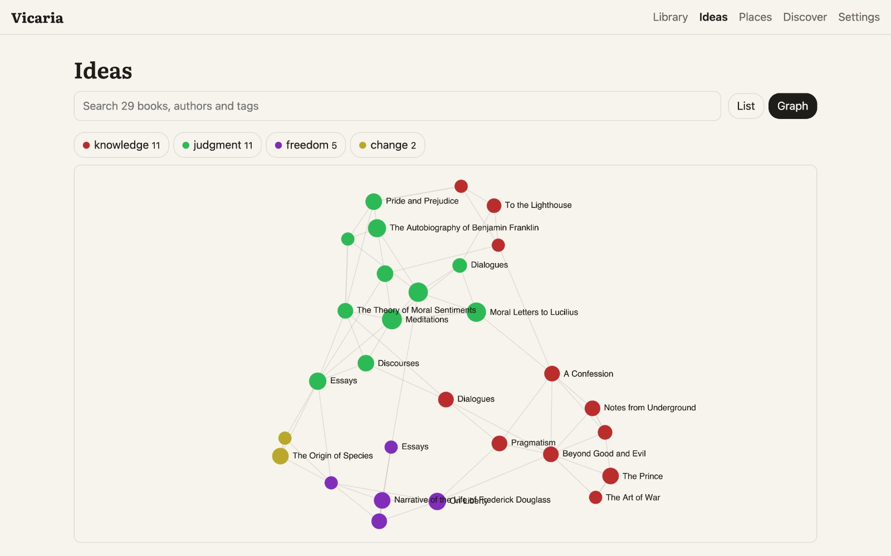
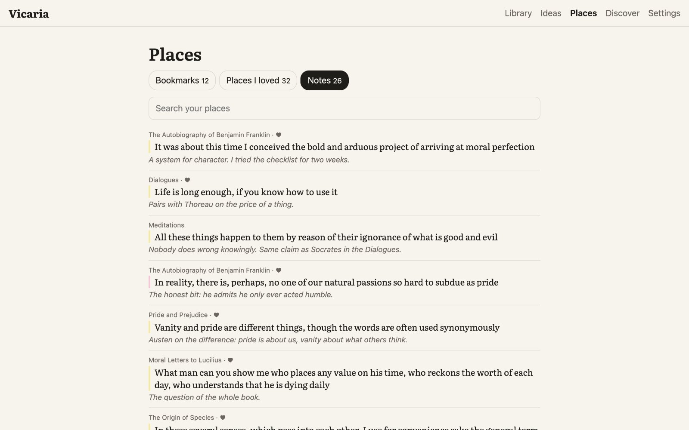
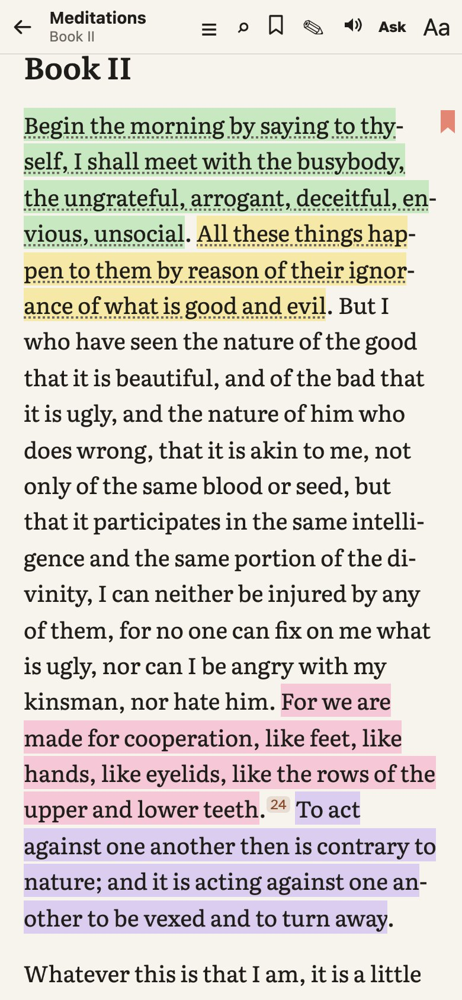
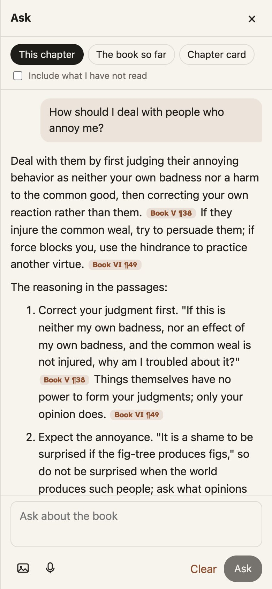
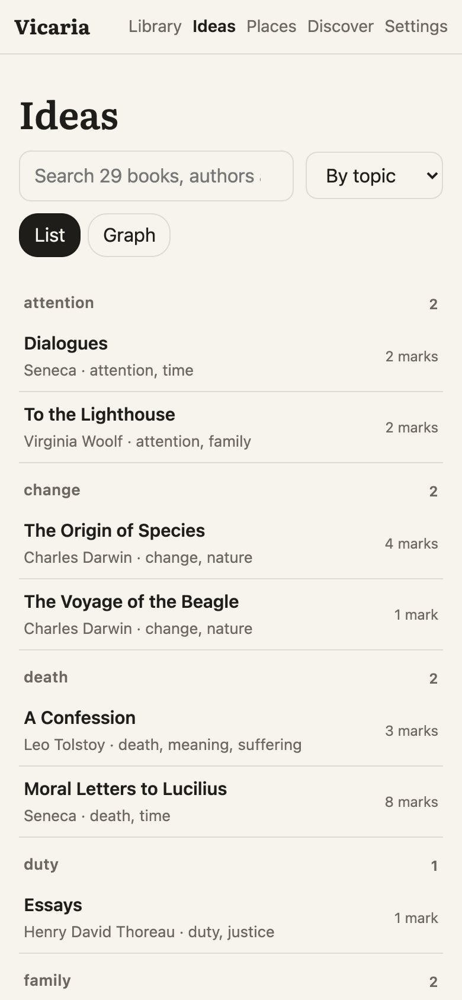

<p align="center"></p>

# Vicaria

**Read a book, ask it anything, keep what it taught you.**

<p align="center">
  <picture>
    <source media="(prefers-color-scheme: dark)" srcset="docs/media/ask-desktop-dark.jpg">
    
  </picture>
</p>

[**Open in your browser**](https://luisfpal.github.io/vicaria/) · [**Android**](https://github.com/luisfpal/vicaria/releases/latest) · [**Mac and Linux**](https://luisfpal.github.io/vicaria/get/)

Free and open source. No account.

## What you get

- **Ask the book.** Answers quote the passages they came from. Tap one to jump to the page. Only what you have read is used, so nothing is spoiled.
- **Keep the ideas.** Highlight as you read. Ideas shows how your books connect.
- **Listen.** Any book read aloud with a voice that runs on your device.
- **Yours alone.** Books, notes and keys stay on your devices. Sync by scanning a code.

<p align="center">
  
  
</p>
<p align="center">
  
  
</p>
<p align="center">
  
  
  
  
  
</p>

<sub>The screenshots show a demo library of free books from Standard Ebooks. Rebuild it with `app/e2e/demo-seed.mjs`; see `docs/media/demo-state/README.md`.</sub>

## Install

| Where | How |
|---|---|
| Any browser | [Open Vicaria](https://luisfpal.github.io/vicaria/), then choose **Install app**. It works offline after the first visit. |
| iPhone and iPad | Open it in Safari, tap **Share**, then **Add to Home Screen**. |
| Android | Download the APK from [Releases](https://github.com/luisfpal/vicaria/releases/latest). To keep it updated, add `https://github.com/luisfpal/vicaria` to [Obtainium](https://obtainium.imranr.dev/) (or open `obtainium://add/https://github.com/luisfpal/vicaria` on the phone). |
| Mac and Linux | `curl -fsSL https://luisfpal.github.io/vicaria/install.sh \| sh`, or pick a download on the [Get page](https://luisfpal.github.io/vicaria/get/). |

The Mac app is not signed with an Apple developer account, so the line above is the way to open it without a warning. The Linux AppImage needs FUSE 2 (`sudo apt install libfuse2t64` on Ubuntu 24.04 and later). The desktop apps check for updates at launch and every six hours.

## Books

A classic is waiting on your shelf the first time you open it. **Discover** searches free books from [Standard Ebooks](https://standardebooks.org) and [Project Gutenberg](https://www.gutenberg.org), or add any DRM-free EPUB or PDF you own. Nothing passes through a server of ours.

## AI

In **Settings**, pick a provider and add your key. [OpenRouter](https://openrouter.ai) is the easiest: sign in with it (no key to copy) and one account reaches Claude, GPT, Grok, Gemini and DeepSeek on pay-as-you-go credits. Or use DeepSeek, OpenAI, Anthropic, Google Gemini or xAI directly with a key you already have. The model is yours to change, and Vicaria reads the provider's own list so a retired model is replaced by a current one. Keys stay on your device and requests go straight to the provider. Reading, highlights and listening work without AI.

## Sync

Tap **Sync**, then point your other device's camera at the code. Devices talk to each other directly. When they cannot, an encrypted copy of your changes waits on public [Nostr](https://nostr.com) relays for up to 30 days. The relays cannot read it: only devices that scanned your code hold the key. You can add your own relay, or move changes with a file.

Positions, highlights, reading settings and chapter cards sync. Books move between your devices on request, straight from one to the other.

## Privacy

Your books, notes and keys stay on your devices. The site only serves the app's files. AI requests go from your device to the provider you chose. The full list of what leaves your device, and when, is on the Privacy page in the app (Settings, Privacy).

## Known limits

- PDFs: right-to-left text reads in the right order. Vertical text (Japanese, Chinese) reads left to right, line by line.
- PDFs that are only pictures (scans without text) can be read and highlighted, but not searched, read aloud or asked about.
- The first PDF needs a connection once, to fetch the PDF reader (about 650 KB).

## Build

The desktop and Android apps are a thin [Tauri](https://tauri.app) shell around the same web app (`app/src-tauri`): `cd app && npx tauri build` for the desktop app, `npx tauri android build --apk` for Android (JDK 17, the Android SDK and NDK 27). A tag like `v1.0.0` makes `.github/workflows/release.yml` build every download and the update file, and leave a draft release to publish.

```
python3 standalone/build.py --base /vicaria
python3 standalone/serve_static.py standalone/dist 8000 /vicaria
```

Then open http://localhost:8000/vicaria/.

## Documentation

[Architecture](docs/ARCHITECTURE.md) · [Releasing and updates](docs/RELEASING.md) · [Stored data and migrations](docs/MIGRATIONS.md) · [Performance decisions](docs/perf/perf-decisions.md) · [Contributing](CONTRIBUTING.md) · [Security](SECURITY.md) · [Changelog](CHANGELOG.md)

## License

Copyright © 2026 Luis Palacios. Licensed under the [GNU Affero General Public License v3.0 or later](LICENSE). See [CONTRIBUTING](CONTRIBUTING.md) and [TRADEMARK](TRADEMARK.md).
